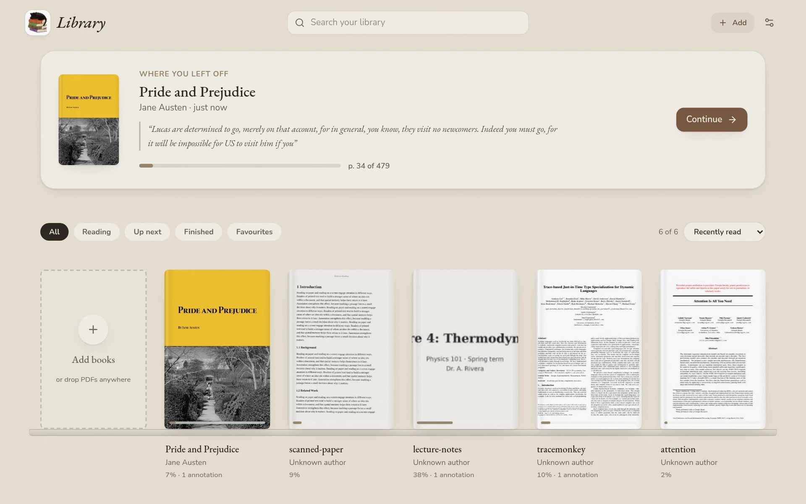
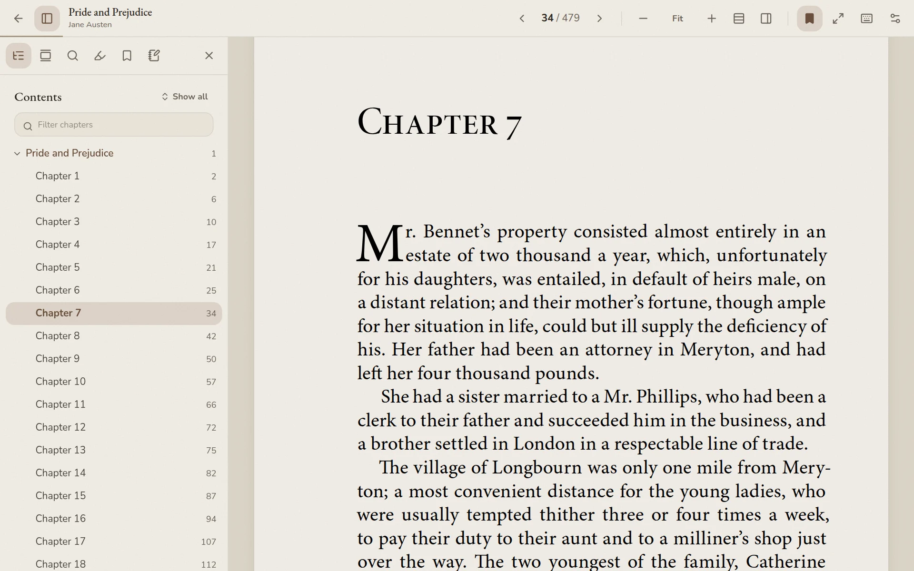

<p align="center">
  
</p>

<h1 align="center">Library</h1>

<p align="center">
  A light-weight, cozy, open-source PDF reader for reading and studying, kept entirely on your own computer.
  <br />
  <a href="https://github.com/zawgatron-cal/library/releases/latest"><strong>Download for macOS, Windows or Linux</strong></a>
</p>

Library is built around one idea: reading should feel handcrafted. Soft themes, warm paper tones, gentle typography, and a quiet interface that gets out of the way so you can sink into a book, a paper, or a course reader.

<p align="center">
  
  
</p>

## Download

Get the latest version from the [Releases page](https://github.com/zawgatron-cal/library/releases/latest).

| System | File |
| --- | --- |
| macOS, Apple silicon (M1 and later) | `Library-…-mac-arm64.dmg` |
| macOS, Intel | `Library-…-mac-x64.dmg` |
| Windows 10 and 11 | `Library-…-win-x64.exe` |
| Linux, any distribution | `Library-…-linux-x86_64.AppImage` |
| Debian, Ubuntu, Mint, Pop!_OS | `Library-…-linux-amd64.deb` |

The `arm64` AppImage and deb are for Linux on ARM.

**First launch.** Library isn't signed with a paid Apple or Microsoft developer certificate yet, so your system checks with you the first time you open it.

- **macOS — “can't verify” / “malware” message:** This is Gatekeeper, not a virus scan. After you drag Library into **Applications**, **control-click Library → Open → Open** (do not double-click the first time). Or double-click once, cancel the alert, then **System Settings → Privacy & Security → Open Anyway**. Full steps: [`docs/INSTALL-macos.md`](docs/INSTALL-macos.md).
- **Windows**: if SmartScreen says "Windows protected your PC", click **More info → Run anyway**.
- **Linux**: make the AppImage executable (`chmod +x Library-*.AppImage`) and run it, or install the deb with `sudo apt install ./Library-*.deb`.

**Your data** (books, annotations, notes and settings) is stored by the app on your computer:

- macOS: `~/Library/Application Support/Library`
- Windows: `%APPDATA%\Library`
- Linux: `~/.config/Library`

Uninstalling the app leaves it in place. To start over, delete that folder.

**Updates.** The desktop app checks [GitHub Releases](https://github.com/zawgatron-cal/library/releases/latest) shortly after launch, then about every 12 hours.

- **Windows** and **Linux AppImage**: Library can download and install a newer version in the background, then ask you to restart.
- **macOS** and **Linux `.deb`**: you get a dialog with a link to the right installer. In-app install on macOS needs an Apple Developer ID and notarization; until then, download the new `.dmg` like the first install.

Use the current **1.0.2** build from Releases when published. **1.0.1** added update checks (re-download if an earlier 1.0.1 crashed with a missing `update.cjs`). **1.0.0** has no update checks.

## Features

### Your shelves

- **Add books** from the tile at the start of your shelves, or drag one or many PDFs anywhere onto the window. Title and author are read from the file's metadata, and a cover is rendered from the first page. Password-protected PDFs ask for their password once, and files saved without a `.pdf` extension are recognised by their contents.
- **Stored locally** on your computer. Nothing is uploaded anywhere, and it all works offline.
- **Where you left off**: the book you were last reading, with the last thing you annotated in it.
- **Book details**: right-click any book (or use its menu) to edit its title, author and shelves, mark it finished or favourite, and see pages, time spent reading, annotations and bookmarks.
- **Archive** a book with one click to take it off your shelves without deleting anything; an _Archived_ filter brings it back.
- Reading progress on every cover, filters for _Reading_, _Up next_, _Finished_ and _Favourites_, **shelves (tags)**, search, and sorting by recently read, recently added, title, author or progress.
- Opening a book grows its cover into the page you left off on, and closing it shrinks the page back onto the shelf.

### Reading

- **Pages**: continuous scroll, one page at a time, or two-page spreads.
- **Scroll direction**: vertical or horizontal, in any page layout.
- Virtualized page rendering, so a book with a thousand pages still feels light.
- **Smooth zoom**: pinch or <kbd>Ctrl/⌘</kbd>+scroll to zoom around your cursor, or use the zoom slider. Pages stay sharp while they re-render.
- **Go to page** by printed page number (like _xii_), PDF page, or percentage, with a **Back** pill to return after any jump.
- Your **place is remembered** in every book, along with its zoom level.
- **Page thumbnails** in the sidebar for skimming, marked with bookmarks and annotation counts.
- **Table of contents** from the PDF's own outline: a collapsible tree that follows the current chapter, with _Show all_ / _Collapse all_ and a filter for long outlines. Titles set in capitals are shown in title case.
- **Rotate** the whole view (<kbd>R</kbd> / <kbd>Shift R</kbd>) or a single page from the View menu or its thumbnail. Annotations and recognised text turn with the page.
- **Full-text search** with in-page match marks.
- **Text recognition (OCR)** for scans, photographed pages and lecture slides that are only images. Library notices when a PDF has no text and reads it in the background, starting from the page you're on. Afterwards you can select, highlight and search the text like any other PDF. Sideways pages are detected and turned upright. Recognition runs entirely on your device with a bundled English model ([Tesseract](https://github.com/naptha/tesseract.js)). It handles printed and typed text well; handwriting is hit-and-miss. Start, pause or redo it from a book's details.
- **Focus mode** hides everything except the page.
- **Keyboard shortcuts** for everything (press <kbd>?</kbd> in the reader).

### Studying

- **Annotations** in five soft colours, made by selecting text. Add a note to any annotation.
- **Margin notes**: show each page's annotations alongside it in the margin.
- **Bookmarks** with optional labels. A ribbon marks bookmarked pages; click the ribbon corner of any page to toggle it.
- **Notes**: a lined notepad for each book, with one-click page references.
- **Export** annotations, notes and bookmarks to Markdown.

### Settings

- **Eight themes** for a study by day or a library after hours. Each is a quiet, near-monotone palette: an accent for buttons and ribbons, and a softer flourish from the same family for progress and gilt details.
  - Light: _Parchment_ (walnut and sand), _Sage_ (pale greens), _Mist_ (blue-greys) and _Marble_ (grey stone and verdigris).
  - Dark: _Candlelight_ (smoked oak and amber), _Apothecary_ (black glass and sage), _Midnight_ (inky blue-greys) and _Dusk_ (faded violet and ash).
- **Create your own**: pick seven colours (background, surface, ink, pencil, accent, flourish, paper) and everything else is mixed from them.
- **Page colour**: keep pages original, tint them toward the theme's paper colour, or switch to night pages, which recolour the PDF to match dark themes. Tint strength is adjustable.
- **Interface font** (Nunito, Garamond, Literata, Atkinson Hyperlegible or your system font), interface size, corner roundness, page spacing, paper grain, and reduced motion.

## Keyboard shortcuts

| Keys                     | Action                 |
| ------------------------ | ---------------------- |
| <kbd>→</kbd> / <kbd>K</kbd> | Next page           |
| <kbd>←</kbd> / <kbd>J</kbd> | Previous page       |
| <kbd>G</kbd>             | Go to page             |
| <kbd>Backspace</kbd> / <kbd>Delete</kbd> | Delete selected annotation |
| <kbd>Backspace</kbd>     | Back after a jump      |
| Type after selecting     | Highlight and start a note |
| <kbd>⌘/Ctrl</kbd>+<kbd>Enter</kbd> | Save note        |
| <kbd>Esc</kbd>           | Cancel note / close    |
| <kbd>+</kbd> / <kbd>−</kbd> | Zoom in / out       |
| <kbd>0</kbd>             | Fit                    |
| <kbd>D</kbd>             | Two pages              |
| <kbd>V</kbd>             | Scroll direction       |
| <kbd>M</kbd>             | Margin notes           |
| <kbd>R</kbd> / <kbd>Shift R</kbd> | Rotate right / left |
| <kbd>B</kbd>             | Bookmark page          |
| <kbd>H</kbd>             | Highlight selection    |
| <kbd>/</kbd> or <kbd>Ctrl/⌘ F</kbd> | Search in book |
| <kbd>T</kbd>             | Toggle sidebar         |
| <kbd>P</kbd>             | Page thumbnails        |
| <kbd>F</kbd>             | Focus mode             |
| <kbd>Esc</kbd>           | Close / exit focus     |

## Building from source

You need [Node.js](https://nodejs.org) 22 or later.

```bash
git clone https://github.com/zawgatron-cal/library.git library
cd library
npm install
npm run dev        # the web version at http://localhost:5173
npm run desktop    # the desktop app
```

| Script | What it does |
| --- | --- |
| `npm run dev` | Start the web dev server |
| `npm run desktop` | Build, then open the desktop app |
| `npm run build` | Type-check and build the web app to `dist/` |
| `npm run dist` | Build installers for the current system into `release/` |
| `npm run dist:mac`, `dist:win`, `dist:linux` | Build installers for one system |
| `npm run lint` | Lint with ESLint |
| `npm run notices` | Regenerate `THIRD_PARTY_NOTICES.md` after changing dependencies |

macOS installers must be built on a Mac. Windows and Linux installers build anywhere, though Windows ones are easiest on Windows.

### Releasing

Pushing a version tag builds the installers on macOS, Windows and Linux with GitHub Actions and publishes them as a release:

```bash
npm version 1.0.2          # bumps package.json and creates the tag v1.0.2
git push && git push --tags
```

The release notes come from `.github/release-notes.md`. To sign the macOS app with an Apple Developer ID, see the comment in `electron-builder.yml`.

The web version can be hosted on any static host: run `npm run build` and serve `dist/`.

## How it's built

React 19, TypeScript, Vite and Tailwind CSS v4, packaged for the desktop with [Electron](https://www.electronjs.org) and [electron-builder](https://www.electron.build), with [react-pdf](https://github.com/wojtekmaj/react-pdf) (pdf.js) for rendering, [tesseract.js](https://github.com/naptha/tesseract.js) for text recognition, and [idb](https://github.com/jakearchibald/idb) for storage. Screen changes use the View Transitions API where the browser supports it.

```
desktop/
  main.cjs        The desktop app: one sandboxed Electron window serving dist/ from app://library
  icons/          The icon artwork and the app icons made from it (make-icons.py)
scripts/
  third-party-notices.mjs  Writes THIRD_PARTY_NOTICES.md from the dependency tree
src/
  lib/
    db.ts           IndexedDB: books, PDF files, annotations, recognised text
    pdf.ts          pdf.js setup, import (metadata + cover), scan detection
    ocr.ts          Background text recognition queue
    geometry.ts     Page rotation maths
    themes.ts       Preset themes and colour helpers
    preferences.ts  Settings shape, fonts, defaults
    settings.tsx    Settings context; applies the theme as CSS variables
    router.ts       Hash routing and screen transitions
    export.ts       Markdown export
  components/
    library/        Shelves, covers, book details
    reader/         Reader, page layout and stack, view controls, sidebar, go-to, annotation popover
    settings/       Appearance & settings sheet
    ui/             Buttons, dialogs, sheets, menus, popovers, toasts
```

Theming works through seven CSS variables (`--canvas`, `--surface`, `--ink`, `--muted`, `--accent`, `--flourish`, `--paper`). Titles are set in EB Garamond. Every other colour, including borders, hovers and soft accents, is derived from them with `color-mix()`. PDF pages are themed with blend-mode overlays: a multiply layer for warm tints, and an inverted canvas mapped onto the theme's ink and paper colours for night pages.

## License

Library's source code is released under the [MIT License](LICENSE).

The icon artwork (the cat on the books) is not covered by the MIT License. See [`desktop/icons/LICENSE.md`](desktop/icons/LICENSE.md): you may use it to represent Library, but please give forks their own icon.

Library is built on many open-source projects, including pdf.js, Tesseract, React, Electron and the EB Garamond, Nunito, Literata and Atkinson Hyperlegible fonts. Their licenses are collected in [THIRD_PARTY_NOTICES.md](THIRD_PARTY_NOTICES.md) and installed alongside the app. You can also find them from **Settings → About**.
